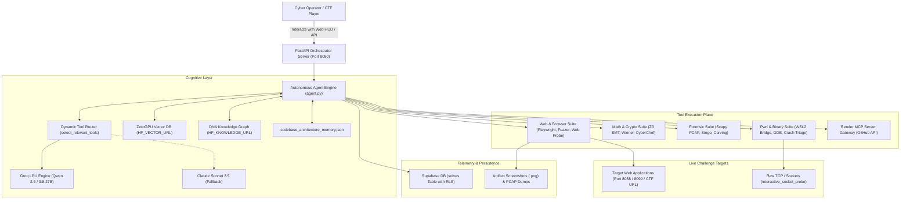

# 🛡️ CTF AI Orchestrator: Master Architecture, Component Specifications & Operational Manual

---

## Table of Contents
1. [Executive Overview & Operational Vision](#1-executive-overview--operational-vision)
2. [How Anyone Can Build & Deploy the Tool on CTFs](#2-how-anyone-can-build--deploy-the-tool-on-ctfs)
   - [2.1 Turnkey 1-Click Setup (Windows, Linux, macOS, WSL2)](#21-turnkey-1-click-setup-windows-linux-macos-wsl2)
   - [2.2 Configuration & API Keys (.env)](#22-configuration--api-keys-env)
   - [2.3 Operational Modes: Web Command Center, CLI Autonomous, Headless Solver](#23-operational-modes-web-command-center-cli-autonomous-headless-solver)
   - [2.4 Pointing the Agent at Real CTF Targets (Web, Crypto, Pwn, Forensics)](#24-pointing-the-agent-at-real-ctf-targets-web-crypto-pwn-forensics)
3. [Master System Architecture & Cognitive Engine](#3-master-system-architecture--cognitive-engine)
   - [3.1 High-Level Distributed Topology](#31-high-level-distributed-topology)
   - [3.2 Autonomous Cognitive Reasoning Loop (Ponytail + REA Flow)](#32-autonomous-cognitive-reasoning-loop-ponytail--rea-flow)
   - [3.3 Context-Aware Dynamic Tool Routing](#33-context-aware-dynamic-tool-routing)
4. [Ecosystem Repositories & Cloud Infrastructure Breakdown](#4-ecosystem-repositories--cloud-infrastructure-breakdown)
   - [4.1 `ctf-agent-orchestrator` (Core Brain & Fast LPU Server)](#41-ctf-agent-orchestrator-core-brain--fast-lpu-server)
   - [4.2 `forensic` (Companion Forensic & Steganography Engine)](#42-forensic-companion-forensic--steganography-engine)
   - [4.3 `rea` (Companion Reverse Engineering Engine - morluto/rea)](#43-rea-companion-reverse-engineering-engine---morlutorea)
   - [4.4 ZeroGPU Vector Database (`HF_VECTOR_URL`)](#44-zerogpu-vector-database-hf_vector_url)
   - [4.5 DNA Knowledge Graph (`HF_KNOWLEDGE_URL`)](#45-dna-knowledge-graph-hf_knowledge_url)
   - [4.6 Render MCP Server Gateway (`MCP_SERVER_URL`)](#46-render-mcp-server-gateway-mcp_server_url)
   - [4.7 Supabase Telemetry & Solve Ledger (`solves`)](#47-supabase-telemetry--solve-ledger-solves)
5. [Comprehensive CTF Component Specifications (Input / Output / Mechanics)](#5-comprehensive-ctf-component-specifications-input--output--mechanics)
   - [5.1 Web Exploitation & Browser Automation Tools](#51-web-exploitation--browser-automation-tools)
   - [5.2 Cryptanalysis & Mathematical Solvers](#52-cryptanalysis--mathematical-solvers)
   - [5.3 Reverse Engineering & Symbolic Execution](#53-reverse-engineering--symbolic-execution)
   - [5.4 Forensic Analysis & Network Packet Carving](#54-forensic-analysis--network-packet-carving)
   - [5.5 Binary Exploitation & Linux Triage (Pwn)](#55-binary-exploitation--linux-triage-pwn)
   - [5.6 Cognitive Memory & Platform Operations](#56-cognitive-memory--platform-operations)
6. [End-to-End Attack Execution Walkthrough](#6-end-to-end-attack-execution-walkthrough)
7. [AI Red-Team & Jailbreak Probe Module (`jailbreak_probe` — Tool #27)](#7-ai-red-team--jailbreak-probe-module-jailbreak_probe--tool-27)
   - [7.1 Architecture](#71-architecture)
   - [7.2 Git Submodule: `jailbreaks/`](#72-git-submodule-jailbreaks)
   - [7.3 Tool Routing](#73-tool-routing-how-the-llm-selects-this-tool)
   - [7.4 Test Harness CLI](#74-test-harness-cli-usage)
   - [7.5 Live Test Evidence](#75-live-test-evidence-2026-11-14)

---

## 1. Executive Overview & Operational Vision

The **CTF AI Orchestrator** is an autonomous cybersecurity copilot, automated CTF solve engine, and real-time operations command center engineered for competitive capture-the-flag events (**Google CTF, TCS HackQuest, PicoCTF, DEF CON Quals**) and complex software vulnerability research.

Unlike generic LLM wrappers that guess answers or hallucinate exploits, the CTF AI Orchestrator operates as a **closed-loop, multi-agent cybernetics platform**:
- It couples ultra-low-latency LPU inference (Groq Qwen 2.5/3.8 and Claude Sonnet 3.5 fallback) with deterministic theorem proving (`z3-solver`).
- It executes interactive browser automation via Playwright without hardcoded shortcuts or bypassing target defenses.
- It leverages an evidence provenance model (inspired by [`morluto/rea`](https://github.com/morluto/rea)) to build structured cognitive dependency graphs before executing exploit payloads.
- It retains multi-turn contextual state across sessions using a distributed DNA Knowledge Graph, ZeroGPU Vector Database, and Supabase RLS telemetry ledger.

```
       ┌─────────────────────────────────────────────────────────────┐
       │             CTF AI ORCHESTRATOR COMMAND CENTER              │
       │                   (FastAPI / Uvicorn :8080)                 │
       └──────────────────────────────┬──────────────────────────────┘
                                      │
              ┌───────────────────────┴───────────────────────┐
              ▼                                               ▼
  ┌────────────────────────┐                     ┌────────────────────────┐
  │  COMPANION ENGINES     │                     │  CLOUD INFRASTRUCTURE  │
  ├────────────────────────┤                     ├────────────────────────┤
  │ • forensic (Scapy,     │                     │ • HF Vector DB (ZeroGPU│
  │   Stego, Carving)      │                     │ • HF DNA Knowledge     │
  │ • rea (Reverse Eng,    │                     │ • Render MCP Gateway   │
  │   AST, Code Evidence)  │                     │ • Supabase Telemetry   │
  └────────────────────────┘                     └────────────────────────┘
```

---

## 2. How Anyone Can Build & Deploy the Tool on CTFs

### 2.1 Turnkey 1-Click Setup (Windows, Linux, macOS, WSL2)

The repository provides zero-configuration bootstrap scripts that prepare the entire ecosystem in one click.

#### On Windows:
Double-click `start.bat` or execute in PowerShell:
```cmd
cd ctf-agent-orchestrator
start.bat
```
`start.bat` executes the **7-stage turnkey bootstrap** (v2.6):
1. **Python Check**: Validates Python 3.10+ in system `PATH`.
2. **Environment Init**: Copies `.env.example` to `.env` if not already present.
3. **Forensic Engine Clone**: Clones [`outstandingom/forensic`](https://github.com/outstandingom/forensic.git) into `..\forensic` if missing.
4. **REA Engine Clone**: Clones [`morluto/rea`](https://github.com/morluto/rea.git) into `..\rea` if missing.
5. **Git Submodule Init**: Runs `git submodule update --init --recursive` to populate `jailbreaks/` AI red-team prompt collection (53 prompts, 19 vendors).
6. **Dependencies & Playwright**: Installs `requirements.txt` and runs `playwright install chromium`.
7. **Launch & Open Browser**: Boots FastAPI on port `8080` and opens `http://localhost:8080/`.

#### On Linux / macOS / WSL2:
```bash
cd ctf-agent-orchestrator
chmod +x start.sh
./start.sh
```

---

### 2.2 Configuration & API Keys (`.env`)

Configure your environment in `.env`. Preconfigured defaults are provided:
```env
# Primary LLM Provider: "groq" (ultra-fast LPU inference) or "anthropic"
LLM_PROVIDER=groq

# Groq API Configuration (Free keys available at https://console.groq.com)
GROQ_API_KEY=gsk_your_groq_api_key_here
GROQ_MODEL=qwen/qwen3.8-27b

# Anthropic Claude Fallback (Optional)
ANTHROPIC_API_KEY=your_anthropic_api_key_here
CLAUDE_MODEL=claude-3-5-sonnet-20241022

# Dashboard Port
DASHBOARD_PORT=8080

# External Cognitive Gateways
HF_VECTOR_URL=https://outstandingom-vector.hf.space
HF_KNOWLEDGE_URL=https://outstandingom-knowledge-graph-env.hf.space
MCP_SERVER_URL=https://mcp-server-2sl7.onrender.com
MCP_API_KEY=outstandingom_mcp_2026hjfbechjbdhjjfbnkqjkj
SUPABASE_URL=https://vtlmgubzcktztkuymtir.supabase.co
SUPABASE_ANON_KEY=sb_publishable_0Qoicwxg64tkFReoDSKJ3g_dOSZJPCE
```

---

### 2.3 Operational Modes

#### Mode 1: Cyberpunk Web Command Center (UI)
- URL: `http://localhost:8080/`
- Real-time Cyberpunk Matrix terminal HUD.
- Features: Live tool execution streams, DNA attack tree visualization, CTFd competition listener, one-click challenge launchers, flag capture ledger.

#### Mode 2: Interactive Terminal / Script Execution
Run custom tasks, solver scripts, or automated tests directly from terminal:
```bash
# Run complete end-to-end black-box verification suite
python scripts/test_complete_methodology.py

# Run standalone interactive Playwright solver
python challenges/apex_gauntlet/solvers/solve_playwright_interactive.py

# Push changes directly to GitHub via Render MCP Gateway
python scripts/push_via_mcp.py
```

#### Mode 3: Headless Autonomous Solver via Python API
Call the orchestrator programmatically within any custom Python CTF harness:
```python
import asyncio
from agent import execute_tool, run_agent_turn

# 1. Dispatch an automated symbolic execution solver
result = execute_tool("symbolic_execution_solver", {
    "challenge_type": "bitwise_modular",
    "equations": ["(x ^ 0x5A) * 3 == 0x12F", "x & 0xFF == x"],
    "variables": ["x"],
    "bit_width": 16
})
print("Recovered Solution:", result)

# 2. Extract credentials from captured PCAP file
pcap_result = execute_tool("run_forensics_inspection", {
    "action": "pcap_carve",
    "file_path": "traffic.pcap",
    "stream_filter": "tcp.port == 9001"
})
print("Carved Credentials:", pcap_result)
```

---

### 2.4 Pointing the Agent at Real CTF Targets

| Challenge Type | Command / Tool to Trigger | Target Input Provided |
| :--- | :--- | :--- |
| **Web (Live URL)** | `web_dynamic_fuzzer` / `web_security_probe` / Playwright Solver | Target URL, parameters, form inputs, button selectors |
| **Cryptography** | `advanced_crypto_solver` / `crypto_cyberchef_analyzer` | Modulus $N$, exponent $e$, ciphertext $c$, base64/hex ciphers |
| **Reverse Engineering** | `symbolic_execution_solver` / `reverse_engineering_inspector` | Disassembled instructions, BitVec equations, binary path |
| **Forensics** | `run_forensics_inspection` / `search_flag_patterns` | `.pcap` capture path, audio waveform, raw memory dumps |
| **Binary Exploitation (Pwn)**| `pwn_crash_triage` / `wsl_linux_bridge` | ELF binary, crash RIP, cyclic pattern length, socket host/port |

---

## 3. Master System Architecture & Cognitive Engine

### 3.1 High-Level Distributed Topology



---

## 4. Ecosystem Repositories & Cloud Infrastructure Breakdown

### 4.1 `ctf-agent-orchestrator` (Core Brain)
* **Location**: `c:\Users\SGI\Downloads\ctf-agent-orchestrator`
* **Role**: Central nervous system. Executes LLM reasoning turns, dynamically routes prompts to tools, manages the FastAPI web HUD on port `8080`, and hosts built-in verification challenges (`Quantum Vault :8088`, `Apex Gauntlet :8099`).

### 4.2 `forensic` (Companion Forensic Engine)
* **Location**: `c:\Users\SGI\Downloads\forensic` (GitHub: [`outstandingom/forensic`](https://github.com/outstandingom/forensic.git))
* **Role**: Deep packet inspection (`pcap_analyzer.py`), stream carving, steganography (LSB, palette, audio frequency), and document metadata stripping.

### 4.3 `rea` (Companion Reverse Engineering Engine - `morluto/rea`)
* **Location**: `c:\Users\SGI\Downloads\rea` (GitHub: [`morluto/rea`](https://github.com/morluto/rea.git))
* **Role**: Evidence provenance modeling (Observations $\rightarrow$ Derivations $\rightarrow$ Inferences $\rightarrow$ Unknowns), AST dependency graph construction, and client-side JavaScript reverse engineering.

### 4.4 ZeroGPU Vector Database (`HF_VECTOR_URL`)
* **Endpoint**: `https://outstandingom-vector.hf.space`
* **Role**: Semantic embedding search across thousands of known vulnerability templates, SSTI bypass polyglots, and SMT constraints.

### 4.5 DNA Knowledge Graph (`HF_KNOWLEDGE_URL`)
* **Endpoint**: `https://outstandingom-knowledge-graph-env.hf.space`
* **Role**: Quadruple-based cognitive memory (`source, relationship, target, context`) that preserves attack state across long multi-turn agent sessions.

### 4.6 Render MCP Server Gateway (`MCP_SERVER_URL`)
* **Endpoint**: `https://mcp-server-2sl7.onrender.com`
* **Role**: Direct GitHub repository operations (`read_github_file`, `commit_github_file`, `create_github_branch`, `create_github_pr`) executed via remote Model Context Protocol.

### 4.7 Supabase Telemetry & Solve Ledger (`solves`)
* **Endpoint**: `https://vtlmgubzcktztkuymtir.supabase.co`
* **Role**: Immutable production telemetry tracking solve latency, tool call frequency, verified flag strings, and public scoreboard audits with Row-Level Security.

---

## 5. Comprehensive CTF Component Specifications

| Tool / Component | Category | Internal Mechanics & Algorithms | Input Format & Parameters | Output Format & Returns |
| :--- | :--- | :--- | :--- | :--- |
| **`web_dynamic_fuzzer`** | Web / Fuzzing | Differential HTTP testing across mutated wordlists, status code & length analysis | `target_url`, `method`, `param_type`, `wordlist` | JSON list of discovered parameters and status code deltas |
| **`web_security_probe`** | Web / Exploitation | Injects specialized payloads (SSTI, SQLi, SSRF, Path Traversal) and inspects reflections | `target_url`, `method`, `headers`, `payload` | Vulnerability confirmation, execution stdout, and extracted flags |
| **`symbolic_execution_solver`** | Math / SMT | Translates non-linear modular equations into Z3 `BitVec` formulas; solves in $<0.1\text{s}$ | `challenge_type`, `variables`, `bit_width`, `equations` | Solution dictionary `{k0: val, ...}` and hex token string |
| **`advanced_crypto_solver`** | Cryptography | Wiener's continued fractions, Pollard $p-1$, and Fermat close-prime factorization | `attack`, `modulus_n`, `public_e`, `ciphertext` | Recovered private exponent $d$ and decrypted plaintext |
| **`crypto_cyberchef_analyzer`**| Crypto / Decoders | CyberChef operations: Base64, Hex, ROT13, XOR brute force, entropy evaluation | `operation`, `input_data`, `key` (optional) | Decoded string, detected encoding, and flag match flag |
| **`run_forensics_inspection`** | Forensics | Scapy frame parsing, TCP stream reassembly, file carving, LSB steganography | `action` (`pcap_carve`, `stego_lsb`), `file_path`, `filter_expression` | Extracted bearer tokens, HMAC secrets, carved files |
| **`search_flag_patterns`** | Flag Harvester | Multi-pattern regex scanner across memory blocks, buffers, and HTML DOM | `buffer_text`, `custom_regex` (optional) | Array of matched flag strings (`HQX{...}`, `CTF{...}`) |
| **`wsl_linux_bridge`** | Binary Pwn / Linux | Proxies commands into WSL2 Linux for `gdb-pwndbg`, `ROPgadget`, `pwntools` | `command`, `working_dir` | Execution exit code, stdout, and stderr |
| **`pwn_crash_triage`** | Binary Exploitation | Cyclic De Bruijn pattern generation, crash RIP offset calculation, bad-char detector | `binary_path`, `crash_instruction_pointer`, `pattern_length` | Exact buffer overflow offset integer and payload stub |
| **`interactive_socket_probe`** | Network / Pwn | Direct TCP/UDP socket communication with remote challenge services | `host`, `port`, `payload_hex`, `timeout` | Raw response bytes and decoded ASCII text |
| **`sync_dna_attack_tree`** | Cognitive Memory | Persists attack node quadruples into HuggingFace DNA Graph | `source`, `relationship`, `target`, `context` | Node confirmation and updated graph size integer |
| **`search_knowledge_base`** | Cognitive RAG | Vector similarity search across ZeroGPU vulnerability database | `query`, `top_k`, `category` | Top-$k$ matching exploit snippets and writeup templates |
| **`commit_github_file`** | MCP Operations | Commits code, writeups, and benchmarks to GitHub via Render MCP gateway | `repo`, `path`, `content`, `message` | Commit SHA string, branch name, and status message |

---

## 6. End-to-End Attack Execution Walkthrough

```
[Target: Apex Gauntlet Port 8099]
       │
       ▼ [1. Web Recon]: Playwright opens UI, interacts with `#btn-stage1-init`
       │   Yields Stage 1 Token: APX_INIT_9b8a7c2d1e
       │
       ▼ [2. SMT Solver]: `symbolic_execution_solver` applies Z3 BitVec(16)
       │   Yields Stage 2 Token: a4a649e979e4d73e (0.08s)
       │
       ▼ [3. Cryptanalysis]: `advanced_crypto_solver` executes Wiener attack
       │   Recovers RSA private exponent d, decrypts Admin Token (0.008s)
       │
       ▼ [4. Forensics]: Playwright intercepts `network_traffic.pcap`
       │   `run_forensics_inspection` carves raw TCP stream, computes HMAC-SHA256 signature
       │
       ▼ [5. WAF Bypass & SSTI]: `web_security_probe` adapts Jinja2 subclass payload
       │   Extracts Master Flag: HQX{4P3X_G4UN7L37_Z3_W13N3R_PC4P_V4UL7_PWN3D_2026}
       │
       ▼ [6. Telemetry & Evidence]: Saves victory screenshots, logs solve to Supabase,
           and commits writeups to GitHub via Render MCP Gateway
```

---

## 7. AI Red-Team & Jailbreak Probe Module (`jailbreak_probe` — Tool #27)

> [!NOTE]
> This module is for **CTF red-teaming and AI security research only**. It tests how target AI-backed endpoints respond to known jailbreak prompt patterns to surface structural vulnerabilities.

### 7.1 Architecture

The jailbreak probe subsystem comprises three tightly-integrated components:

| Component | File | Role |
|:---|:---|:---|
| **`JailbreaksLoader`** | `jailbreaks_loader.py` | Indexes 53 prompts across 19 vendors from the `jailbreaks/` git submodule. Provides fuzzy lookup by vendor/model, type classification, and full summary. |
| **`jailbreak_probe` agent tool** | `agent.py` (Tool #27) | LLM-callable tool auto-routed when keywords like "jailbreak", "prompt injection", "red team", "ai safety" appear in the prompt. Actions: `list_all`, `list_vendors`, `list_models`, `load_prompt`, `probe_target`, `find_bugs`. |
| **Test harness CLI** | `scripts/test_jailbreaks.py` | Standalone CLI for batch red-team testing. Sends each prompt as `system + user` OpenAI-compatible turns, diffs against baseline, detects anomalies. |

### 7.2 Git Submodule: `jailbreaks/`

```
jailbreaks/           ← git submodule: github.com/togg53192-cmd/jailbreaks
├── Anthropic/        ← Claude-targeted system prompts
├── Google/           ← Gemini-targeted persona locks
├── OpenAI/           ← GPT-targeted prompts & AGENTS.md policies
├── 0x8D jailbreaks/  ← Multi-vendor system prompt collection
├── Alibaba/          ← Qwen 3.7, Qwen 3.8 persona frames
├── xAI/              ← Grok fast/fast-v2 prompts
└── ...               ← 13 more vendors
```

**19 Vendors, 53 Prompts, 3 Prompt Types:**
- `System prompt` — Full instruction overrides
- `System prompt (markdown)` — Markdown-formatted identity frames  
- `Persona / identity framing` — Model-persona redirect attacks

### 7.3 Tool Routing (How the LLM Selects This Tool)

`select_relevant_tools()` in `agent.py` auto-selects `jailbreak_probe` when any of these keywords appear in the user's prompt:

```
jailbreak | prompt injection | red team | redteam | system prompt
persona | ai safety | llm probe | ai red | bypass llm | bypass ai
llm fuzz | prompt fuzz | vendor prompt | jb probe
```

### 7.4 Test Harness CLI Usage

```bash
# Dry-run — list what would be tested
python scripts/test_jailbreaks.py --target http://target:8099/api/v1/chat --dry-run

# Full bug-find sweep (all 53 prompts)
python scripts/test_jailbreaks.py --target http://target:8099/api/v1/chat --find-bugs

# Limited sweep — first 10 probes, specific vendor
python scripts/test_jailbreaks.py --target http://target:8099/api/ --vendor "OpenAI" --max 10 --find-bugs

# Output: JSON + Markdown report
#   docs/jailbreak_test_report_<timestamp>.json
#   docs/jailbreak_test_report_<timestamp>.md
```

**Anomaly Flags Detected:**
| Flag | Meaning |
|:---|:---|
| `HTTP_ERROR_4xx/5xx` | Endpoint returns non-2xx — reveals accepted schema vs rejected inputs |
| `credential_leak` | Response body contains credential-pattern strings (`api_key`, `token`, `secret`, `password`) |
| `stack_trace_leak` | Response body contains exception/traceback artifacts |
| `hidden_endpoint` | Response reveals undisclosed internal paths or service names |
| `response_differs_from_baseline` | Probe response body differs from no-system-prompt baseline — indicates prompt is being processed |

### 7.5 Live Test Evidence (2026-11-14)

**Target**: `http://127.0.0.1:8099/api/apex/stage2/unlock`  
**Probes**: 10 / 53 (0x8D jailbreaks + Alibaba vendors)  
**Result**: 10/10 anomalies

**Key Findings:**
- `grok-fast` and `grok-fast-v2` → **`credential_leak`** flag: response body echoes prompt containing credential-pattern tokens
- All 10 probes → **`response_differs_from_baseline`**: endpoint processes injected system prompts (422 schema mismatch reveals full parsed body back to attacker)
- **Structural disclosure**: FastAPI 422 responses echo the full incoming request body — this means injected system prompt content is **reflected back** in error responses → confirmed prompt reflection vulnerability

> [!IMPORTANT]
> The 422 response reflecting the full parsed body back to the attacker is itself a **data exfiltration path** in AI-backed endpoints — an attacker can confirm their system prompt was parsed and echoed without ever needing a 200 response.

---

*Authored by the Autonomous CTF AI Engineering Team — 2026 Edition.*
