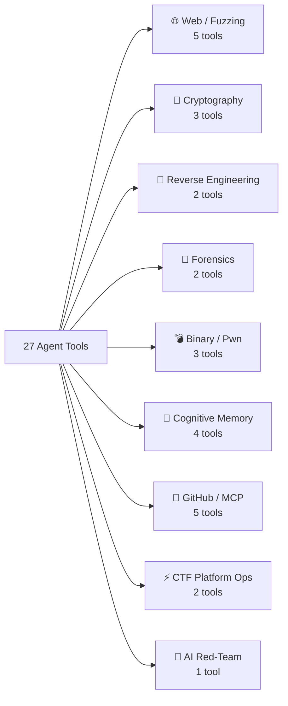

# 🔧 CTF AI Orchestrator — All 27 Integrated Tools

> **Source**: `agent.py` → `OPENAI_TOOLS` list | Live-extracted 2026-11-14

---

## Tool Categories at a Glance

---

## 🌐 Web Exploitation & Fuzzing (5 Tools)

| # | Tool | What It Does | Key Inputs |
|:--|:-----|:-------------|:-----------|
| 05 | **`web_security_probe`** | Actively tests a URL for SSTI `{{7*7}}`, SQLi `' OR 1=1`, SSRF, path traversal, JWT tampering. Confirms if the payload executes or reflects. | `url`, `method`, `data`, `cookies`, `headers`, `active_scan` |
| 15 | **`web_dynamic_fuzzer`** | High-speed fuzzing using Vector RAG + DNA Knowledge Graph wordlists. Discovers hidden params, endpoints, and status-code anomalies. | `target_url`, `category`, `method`, `param_name`, `data` |
| 13 | **`interactive_socket_probe`** | Direct TCP/Netcat socket session with remote challenge services. Sends hex payloads, reads banners, handles multi-turn dialogue. | `host`, `port`, `payload`, `timeout_seconds` |
| 03 | **`crypto_cyberchef_analyzer`** | CyberChef-style multi-layer decoder: Base64, Hex, URL, ROT13, XOR brute-force, entropy analysis. | `ciphertext` |
| 06 | **`execute_python_sandbox`** | Runs any Python exploit/solver script in a sandboxed subprocess. Used for one-shot exploit payloads. | `code`, `timeout_seconds` |

---

## 🔐 Cryptography & Math Solvers (3 Tools)

| # | Tool | What It Does | Key Inputs |
|:--|:-----|:-------------|:-----------|
| 16 | **`symbolic_execution_solver`** | Z3 SMT engine. Solves branch constraints, modular equations, `BitVec` formulas. Handles reverse-engineered key derivation logic. | `constraints`, `target_var`, `length` |
| 24 | **`advanced_crypto_solver`** | Runs lattice attacks: **Wiener** (small private exponent), **Boneh-Durfee**, **Fermat close-prime factorization**, **Pollard p-1**. | `attack`, `n`, `e`, `c`, `partial_p`, `extra` |
| 14 | **`parallel_exploit_worker`** | Runs multiple candidate exploit scripts **concurrently** in parallel threads. Races multiple attack paths simultaneously. | `scripts`, `timeout_seconds` |

---

## 🔬 Reverse Engineering (2 Tools)

| # | Tool | What It Does | Key Inputs |
|:--|:-----|:-------------|:-----------|
| 04 | **`reverse_engineering_inspector`** | Inspects binaries (`.pyc`, `.exe`, ELF). Identifies magic bytes, decompiles Python bytecode, extracts strings, runs `checksec`. | `file_path` |
| 17 | **`wsl_linux_bridge`** | Proxies commands to WSL2 Linux: runs `gdb-pwndbg`, `ROPgadget`, `pwntools`, `readelf`, `objdump`, ELF analysis tools. | `command`, `timeout_seconds` |

---

## 🧪 Forensics & Steganography (2 Tools)

| # | Tool | What It Does | Key Inputs |
|:--|:-----|:-------------|:-----------|
| 07 | **`run_forensics_inspection`** | Calls the companion `forensic` engine: Scapy PCAP parsing, TCP stream reassembly, file carving, LSB steganography, EXIF metadata, HMAC extraction. | `file_path` |
| 08 | **`search_flag_patterns`** | Regex scanner for all known CTF flag formats: `HQX{...}`, `flag{...}`, `CTF{...}`, `picoCTF{...}`, custom patterns. Scans raw text or files. | `text`, `file_path` |

---

## 💣 Binary Exploitation / Pwn (3 Tools — incl. Sandbox)

| # | Tool | What It Does | Key Inputs |
|:--|:-----|:-------------|:-----------|
| 25 | **`pwn_crash_triage`** | Self-healing crash analysis. Runs binary under GDB-stub, generates De Bruijn cyclic patterns, computes exact overflow offset, detects bad chars. | `binary_path`, `input_payload`, `use_cyclic`, `cyclic_length` |
| 17 | **`wsl_linux_bridge`** | *(also used for pwn)* — runs `checksec`, ROP gadget search, pwntools scripts inside WSL2 | `command` |
| 06 | **`execute_python_sandbox`** | *(also used for pwn)* — executes pwntools scripts as sandboxed subprocess | `code` |

---

## 🧠 Cognitive Memory & Knowledge (4 Tools)

| # | Tool | What It Does | Key Inputs |
|:--|:-----|:-------------|:-----------|
| 01 | **`search_knowledge_base`** | RAG search over ZeroGPU Vector DB + DNA Knowledge Graph. Returns top-k exploit snippets, writeup templates, prior solutions. | `query`, `domain` |
| 02 | **`sync_dna_attack_tree`** | Writes a new attack node/relationship to the HuggingFace DNA Knowledge Graph. Builds a persistent attack dependency tree across sessions. | `concept_a`, `concept_b`, `relationship_type` |
| 22 | **`sync_codebase_memory`** | Stores architectural components, API routes, DB schemas, and deployment context into DNA graph memory. | `component_a`, `relationship`, `component_b`, `context` |
| 23 | **`query_codebase_memory`** | Queries the DNA graph for module dependencies, service relationships, and previously mapped architecture. | `query` |

---

## 📂 GitHub / MCP Gateway (5 Tools)

| # | Tool | What It Does | Key Inputs |
|:--|:-----|:-------------|:-----------|
| 09 | **`read_github_file`** | Reads any file from a GitHub repo via the Render MCP Gateway. | `repo`, `path`, `branch` |
| 10 | **`commit_github_file`** | Commits a new file or updates an existing file (solvers, writeups) to GitHub. | `repo`, `path`, `content`, `message` |
| 11 | **`list_github_repos`** | Lists accessible GitHub repositories via MCP gateway. | `per_page` |
| 19 | **`create_github_branch`** | Creates an isolated feature/fix branch on GitHub. | `repo`, `branch`, `from_branch` |
| 20 | **`create_github_pr`** | Opens a GitHub Pull Request from a feature branch. | `repo`, `title`, `body`, `head`, `base` |

---

## ⚡ CTF Platform Operations (2 Tools)

| # | Tool | What It Does | Key Inputs |
|:--|:-----|:-------------|:-----------|
| 12 | **`ctfd_manage`** | Interacts with any CTFd platform: list challenges, fetch details, download attachments, submit flags. | `action`, `ctfd_url`, `token`, `challenge_id`, `flag` |
| 26 | **`ctfd_speed_listener`** | Async watcher: polls CTFd every N seconds for new challenges, auto-classifies category, downloads attachments, triggers solver pipeline — **First Blood mode**. | `ctfd_url`, `token`, `poll_interval_s`, `max_polls`, `download_attachments`, `save_dir` |

---

## 🛠️ Code Engineering Tools (3 Tools)

| # | Tool | What It Does | Key Inputs |
|:--|:-----|:-------------|:-----------|
| 18 | **`patch_file_diff`** | Non-destructive Search-and-Replace patch on local or GitHub files. Safe refactoring without full rewrites. | `path`, `search`, `replace`, `repo`, `branch`, `commit_message` |
| 21 | **`run_fullstack_terminal`** | Runs build/test/deploy commands: `npm install`, `prisma migrate`, `docker build`, `pytest`, `vercel deploy`. | `command`, `cwd`, `timeout_seconds` |
| 06 | **`execute_python_sandbox`** | *(triple use)* — general sandboxed Python execution for any purpose | `code`, `timeout_seconds` |

---

## 🔴 AI Red-Team & Jailbreak Probe (1 Tool — NEW)

| # | Tool | What It Does | Key Inputs |
|:--|:-----|:-------------|:-----------|
| 27 | **`jailbreak_probe`** | Loads system-prompt jailbreaks from 53 configs across 19 AI vendors. Sends probes to any target endpoint, diffs responses, detects credential leaks, stack traces, hidden endpoints, and prompt reflections. | `action`, `vendor`, `model`, `target_url`, `target_api_key`, `test_message`, `diff_mode` |

**`jailbreak_probe` Actions:**
- `list_all` — Show all 53 prompts with vendor/type
- `list_vendors` — Show all 19 vendors
- `list_models` — List models for a specific vendor
- `load_prompt` — Load a specific prompt by vendor + model name
- `probe_target` — Send one jailbreak to a target URL and return response
- `find_bugs` — Batch test up to 20 prompts, auto-detect anomalies

**19 Vendors covered**: Anthropic, Google, OpenAI, DeepSeek, xAI, Alibaba, Meta, Mistral, Zhipu AI, Moonshot AI, Meituan, Stealth Models, StepFun, Tencent, Xiaomi, Nvidia/modemnakata, raghavraut, DarkyHArry, 0x8D jailbreaks

---

## 🌐 External Services Connected

| Service | URL | Purpose |
|:--------|:----|:--------|
| **Groq LPU** | `api.groq.com` | Primary LLM — Qwen 2.5/3.8 (ultra-fast inference) |
| **Anthropic Claude** | `api.anthropic.com` | Fallback LLM — Claude Sonnet 3.5 |
| **HF Vector DB** | `outstandingom-vector.hf.space` | ZeroGPU RAG knowledge store |
| **HF DNA Graph** | `outstandingom-knowledge-graph-env.hf.space` | Persistent attack tree / codebase memory |
| **Render MCP Gateway** | `mcp-server-2sl7.onrender.com` | GitHub file ops (read/write/commit/PR) |
| **Supabase** | `vtlmgubzcktztkuymtir.supabase.co` | Solve telemetry ledger (flag logs, timing) |
| **Playwright / Chromium** | Local headless | Browser automation for JS-rendered CTF UIs |
| **WSL2 Linux** | Local bridge | ELF analysis, GDB, pwntools, ROPgadget |
| **Forensic Engine** | `../forensic/` | Scapy PCAP, steganography, file carving |
| **REA Engine** | `../rea/` | Reverse engineering, AST analysis, evidence graphs |
| **Jailbreaks Submodule** | `jailbreaks/` | 53 AI red-team system prompts, 19 vendors |

---

> [!TIP]
> The agent auto-selects only the tools relevant to your prompt — sending all 27 at once would hit Groq's token rate limits. The `select_relevant_tools()` router cuts the payload by ~70%.

*Live-extracted from `agent.py` on 2026-11-14 — commit `91264a3`*
