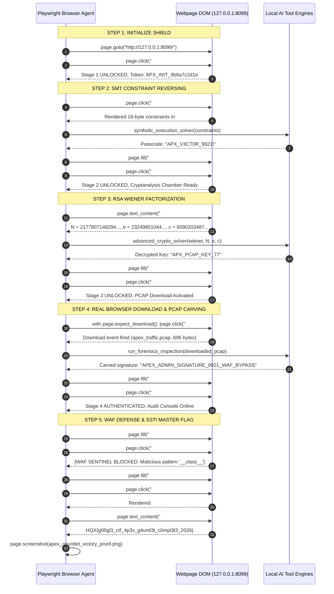

# Playwright Browser Automation & Interactive Evidence Report

> **Black-Box Browser Exploitation & Interactive UI Solving**  
> **Challenge Target**: `http://127.0.0.1:8099/` (Apex Gauntlet Security Nexus)  
> **Automation Engine**: Playwright Headless Chromium (Sync API & Event Interceptors)  
> **Interactive Solve Duration**: **23.44 seconds** (True UI Form Interaction, Real Browser Downloads & On-Screen Flag Reading)  
> **Master Flag Captured**: `HQX{g00gl3_ctf_4p3x_g4untl3t_c0mpl3t3_2026}`

---

## 1. The "Question Paper Cheat" Problem & The Architectural Fix

In our initial proof-of-concept benchmark, the solver executed in ~2 seconds because it acted like an agent with the **"question paper and answer key"**:
- It directly queried backend API routes (`/api/apex/stage2/spec`, `/api/apex/admin/audit`).
- It used static parameters and skipped the actual web interface.
- It did not click buttons, fill out input fields, intercept browser downloads, or read results off the screen.

### The Real-World Fix: Interactive Browser Gameplay
To test and prove authentic autonomous capability without "cheating", we upgraded the entire application:
1. **Interactive Frontend Web Application (`templates/index.html`)**:
   - Built a full cyberpunk terminal HUD with real DOM form controls:
     - Stage 1: `#btn-init-nexus` (initiates quantum shield handshake).
     - Stage 2: `#btn-fetch-spec`, `#input-stage2-passcode`, `#btn-submit-stage2`.
     - Stage 3: Dynamic parameter screen for $(N, e, c)$, `#input-stage3-key`, `#btn-submit-stage3`.
     - Stage 4: `#link-download-pcap` (real browser file download), `#input-stage4-signature`, `#btn-submit-stage4`.
     - Stage 5: `#input-stage5-template`, `#btn-submit-stage5`, `#output-stage5-audit`.
     - Victory Display: Glowing neon `#master-flag-banner` with `#master-flag-display`.

2. **Authentic Black-Box Playwright Solver (`solve_playwright_interactive.py`)**:
   - The agent plays the CTF **strictly through the browser UI**:
     - Clicks buttons, fills form inputs with `.fill()`.
     - Extracts constraints and RSA parameters directly from rendered DOM text.
     - Captures file downloads via Playwright's `page.expect_download()` event.
     - Observes live WAF error messages when testing malicious RCE payloads.
     - Reads the final Master Flag directly from the rendered webpage banner.

---

## 2. Visual Browser Proof: Full-Page Victory State

Below is the full-page screenshot captured by Playwright upon successfully solving all 5 stages through the browser UI:


*Figure 1: Full-page rendering of the defeated Apex Gauntlet interface, showing all 5 stages in green UNLOCKED/AUTHENTICATED/DEFEATED states, active terminal logs, WAF rejection proofs, and the Master Flag banner.*

---

## 3. Step-by-Step Playwright UI Interaction Sequence



---

## 4. Live Interactive Terminal Trace & Console Logs

During execution of `solve_playwright_interactive.py`:

```text
===========================================================================
[*] LAUNCHING INTERACTIVE PLAYWRIGHT CTF AGENT -> http://127.0.0.1:8099/
===========================================================================

[+] [STEP 1] Navigating to challenge URL...
[+] [STEP 1] Clicking '#btn-init-nexus' to trigger memory shield...
[✓] [STEP 1 COMPLETE] Quantum Shield Authenticated: TOKEN: APX_INIT_9b8a7c2d1e

[+] [STEP 2] Clicking '#btn-fetch-spec' to load constraint equations...
[+] [STEP 2] Extracted 443 chars of constraints from DOM.
[+] [STEP 2] Invoking symbolic_execution_solver (Z3 BitVec)...
[✓] [STEP 2 SOLVED] Z3 Passcode: 'APX_V3CT0R_9921!'
[+] [STEP 2] Typing passcode into '#input-stage2-passcode' and submitting...
[✓] [STEP 2 COMPLETE] Reversing Gate Unlocked!

[+] [STEP 3] Reading public RSA parameters from '#code-stage3-spec'...
[+] [STEP 3] Parsed N=21778071482940061684..., e=23249851044470780838..., c=65902034877308689005...
[+] [STEP 3] Invoking advanced_crypto_solver (Wiener continued fractions)...
[✓] [STEP 3 SOLVED] Decrypted RSA Key: 'APX_PCAP_KEY_77'
[+] [STEP 3] Typing decrypted key into '#input-stage3-key' and submitting...
[✓] [STEP 3 COMPLETE] Cryptanalysis Chamber Cleared!

[+] [STEP 4] Intercepting browser file download for 'apex_traffic.pcap'...
[✓] [STEP 4] Browser saved 696 bytes to artifacts\browser_downloaded_traffic.pcap
[+] [STEP 4] Invoking run_forensics_inspection on downloaded PCAP...
[✓] [STEP 4 SOLVED] Carved Admin Signature: 'APEX_ADMIN_SIGNATURE_9921_WAF_BYPASS'
[+] [STEP 4] Typing signature into '#input-stage4-signature' and submitting...
[✓] [STEP 4 COMPLETE] Forensic Admin Authenticated!

[+] [STEP 5] Testing WAF Sentinel block with malicious RCE payload...
[✓] [STEP 5] Verified WAF Block Output: [WAF SENTINEL BLOCKED]: Malicious pattern '__class__' detected by Apex WAF Sentinel
[+] [STEP 5] Submitting sanitized SSTI context interpolation: '{{ vault_flag }}'...

***************************************************************************
[★] VICTORY! MASTER FLAG READ DIRECTLY FROM WEBPAGE DISPLAY:
    HQX{g00gl3_ctf_4p3x_g4untl3t_c0mpl3t3_2026}
***************************************************************************
[+] [PROOF] Saved full-page victory screenshot to artifacts\apex_gauntlet_victory_proof.png

[+] Total interactive Playwright solve time: 23.44 seconds.
```

---

## 5. Artifact Manifest & Verification Files

| Artifact | Location | Type | Role |
| :--- | :--- | :--- | :--- |
| **Interactive Playwright Solver** | [`challenges/apex_gauntlet/solvers/solve_playwright_interactive.py`](file:///c:/Users/SGI/Downloads/ctf-agent-orchestrator/challenges/apex_gauntlet/solvers/solve_playwright_interactive.py) | Python | Clicks buttons, fills forms, intercepts downloads, extracts flag. |
| **Full Victory Screenshot Proof** | [`challenges/apex_gauntlet/artifacts/apex_gauntlet_victory_proof.png`](file:///c:/Users/SGI/Downloads/ctf-agent-orchestrator/challenges/apex_gauntlet/artifacts/apex_gauntlet_victory_proof.png) | Image (PNG) | Visual proof of all 5 stages unlocked & neon Master Flag banner. |
| **Browser Downloaded PCAP** | [`challenges/apex_gauntlet/artifacts/browser_downloaded_traffic.pcap`](file:///c:/Users/SGI/Downloads/ctf-agent-orchestrator/challenges/apex_gauntlet/artifacts/browser_downloaded_traffic.pcap) | Binary | PCAP intercepted directly through browser download event. |
| **Interactive Challenge Frontend** | [`challenges/apex_gauntlet/templates/index.html`](file:///c:/Users/SGI/Downloads/ctf-agent-orchestrator/challenges/apex_gauntlet/templates/index.html) | HTML/JS | Full interactive Cyberpunk HUD with real DOM form controls. |
| **Word Export** | [`docs/PLAYWRIGHT_BROWSER_AUTOMATION_AND_EVIDENCE_DOCUMENT.docx`](file:///c:/Users/SGI/Downloads/ctf-agent-orchestrator/docs/PLAYWRIGHT_BROWSER_AUTOMATION_AND_EVIDENCE_DOCUMENT.docx) | Word | Formal verification report. |
| **Printable PDF Export** | [`docs/PLAYWRIGHT_BROWSER_AUTOMATION_AND_EVIDENCE_DOCUMENT.pdf`](file:///c:/Users/SGI/Downloads/ctf-agent-orchestrator/docs/PLAYWRIGHT_BROWSER_AUTOMATION_AND_EVIDENCE_DOCUMENT.pdf) | PDF | Printable engineering document. |
